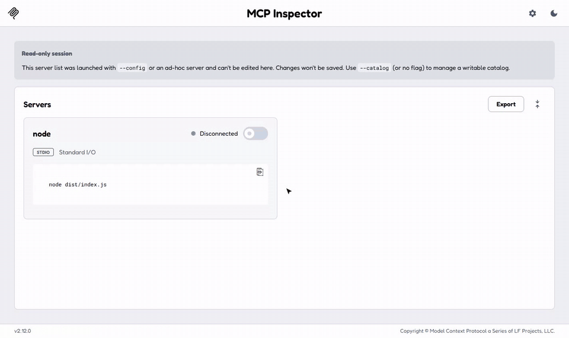
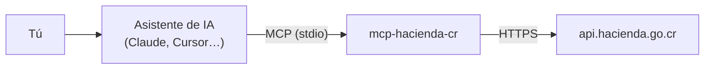

# 🇨🇷 mcp-hacienda-cr

**Servidor MCP que conecta a Claude, Cursor y otros asistentes de IA con los datos públicos del Ministerio de Hacienda de Costa Rica:** tipo de cambio, situación tributaria de contribuyentes, códigos **CABYS** con su IVA y exoneraciones. Pensado para la **facturación electrónica**.

[](https://github.com/jmnzcn/mcp-hacienda-cr/actions/workflows/ci.yml)
[](https://www.npmjs.com/package/mcp-hacienda-cr)


[English summary](#-english-summary) · [Herramientas](#-herramientas) · [Instalación](#-instalación) · [Cómo funciona](#-cómo-funciona)



<sub>Grabado con [MCP Inspector](https://github.com/modelcontextprotocol/inspector) contra la API real de Hacienda: tipo de cambio de hoy, códigos CABYS de "café tostado" con su IVA y la situación tributaria de la CNFL.</sub>

---

## 💬 Qué puedes preguntarle a tu asistente

> **"¿Qué código CABYS uso para vender café tostado y cuánto IVA lleva?"**
>
> Hay 71 códigos para café tostado. Por ejemplo, `2391102010100` (café tostado sin descafeinar, en grano) paga **IVA 1%**, pero `2391102020000` (café tostado **descafeinado**) paga **IVA 13%**.

> **"Antes de facturarle, ¿la empresa 3-101-000046 está al día con Hacienda?"**
>
> COMPAÑIA NACIONAL DE FUERZA Y LUZ S.A. · Cédula jurídica · Inscrita en el régimen general · **al día (no morosa ni omisa)** · Actividad principal: 3510.0, generación, transmisión y distribución de energía eléctrica.

> **"¿A cuánto está el dólar hoy?"** · **"¿La exoneración AL-00020402-24 sigue vigente?"**

Son respuestas reales del servidor contra la API de Hacienda.

---

## 🧰 Herramientas

| Herramienta | Qué hace | Ejemplo de entrada |
|---|---|---|
| `tipo_de_cambio` | Tipo de cambio de referencia de hoy: dólar (compra/venta) y euro | — |
| `consultar_contribuyente` | Nombre, tipo de identificación, régimen, estado, si está **moroso u omiso** y actividades económicas | `3-101-000046` |
| `buscar_cabys` | Busca códigos CABYS por descripción, con su **tarifa de IVA** | `café tostado` |
| `obtener_cabys` | Detalle de un código CABYS: IVA y jerarquía de categorías | `0161001010000` |
| `consultar_exoneracion` | Beneficiario, porcentaje, **vigencia** y CABYS cubiertos de una exoneración | `AL-00020402-24` |

Todas son de **solo lectura** (`readOnlyHint`) y usan APIs públicas de Hacienda: **no necesitan registro, token ni API key**.

---

## 📦 Instalación

Requiere Node.js 18 o superior.

### Claude Desktop

En `claude_desktop_config.json` (Configuración → Desarrollador → Editar configuración):

```json
{
  "mcpServers": {
    "hacienda-cr": {
      "command": "npx",
      "args": ["-y", "mcp-hacienda-cr"]
    }
  }
}
```

### Claude Code

```bash
claude mcp add hacienda-cr -- npx -y mcp-hacienda-cr
```

### Cursor, VS Code y otros clientes MCP

Usa el comando `npx -y mcp-hacienda-cr` con transporte **stdio**.

---

## ⚙️ Cómo funciona



- **TypeScript** con el [SDK oficial de MCP](https://github.com/modelcontextprotocol/typescript-sdk); cada herramienta valida su entrada con **Zod**.
- **Respuestas dobles:** texto legible para la conversación y `structuredContent` para que el modelo trabaje con datos exactos.
- **Errores pensados para el usuario:** una cédula con formato inválido, un código inexistente o la API de Hacienda caída se responden con un mensaje claro, no con una excepción.
- **Caché en memoria:** 10 minutos para el tipo de cambio y 1 hora para el resto, para no saturar la API de Hacienda.
- **Validación local** antes de llamar a la API: cédula física (9 dígitos), jurídica o NITE (10) y DIMEX (11–12); código CABYS de 13 dígitos.

### Calidad

| | |
|---|---|
| **25 tests unitarios** | Cliente de la API y servidor MCP completo (con un cliente MCP real en memoria), usando respuestas reales de Hacienda grabadas |
| **Tests de contrato en vivo** | Contra `api.hacienda.go.cr`: detectan si Hacienda cambia el formato de sus respuestas |
| **Prueba de humo por stdio** | Levanta el servidor compilado como lo haría Claude y llama a las 5 herramientas |
| **CI** | Node 18, 20 y 22 en cada push; contrato en vivo también **cada lunes**, para enterarse antes que los usuarios si la API cambia |

```bash
npm install
npm test            # unitarios (sin red)
npm run test:live   # contrato con la API real de Hacienda
npm run smoke       # servidor compilado por stdio, de punta a punta
```

---

## ⚠️ Aviso

Los datos provienen de las APIs públicas del Ministerio de Hacienda y son **de referencia**. Este proyecto no está afiliado al Ministerio de Hacienda. Confirma las decisiones fiscales con un contador o directamente con Hacienda.

---

## 📜 Licencia

**[PolyForm Noncommercial 1.0.0](LICENSE).** Puedes usarlo gratis para fines no comerciales: uso personal, investigación, educación o evaluarlo. **Cualquier uso comercial requiere una licencia comercial:** [neyfred@gmail.com](mailto:neyfred@gmail.com).

Las versiones hasta el commit `438da02` (2026-10-26), incluida la publicada en npm hasta ese momento, se publicaron con licencia MIT.

## 🇺🇸 English summary

**mcp-hacienda-cr** is a [Model Context Protocol](https://modelcontextprotocol.io) server that lets AI assistants (Claude, Cursor, …) query Costa Rica's Ministry of Finance public APIs: **official exchange rates**, **taxpayer status** (registered, delinquent or non-filer, economic activities), **CABYS product/service codes with their VAT rate**, and **tax exemptions**. It targets e-invoicing, where every invoice line needs a CABYS code and the right VAT rate.

No API keys needed. TypeScript + the official MCP SDK, Zod-validated inputs, text plus structured output, friendly errors, in-memory caching, 25 unit tests, live contract tests, a stdio smoke test, and CI on Node 18/20/22 with a weekly live run.

```bash
claude mcp add hacienda-cr -- npx -y mcp-hacienda-cr
```

---

**Ney Fred Jiménez Campos** · [LinkedIn](https://www.linkedin.com/in/neyfred/) · [GitHub](https://github.com/jmnzcn) · PolyForm Noncommercial · commercial licenses on request
