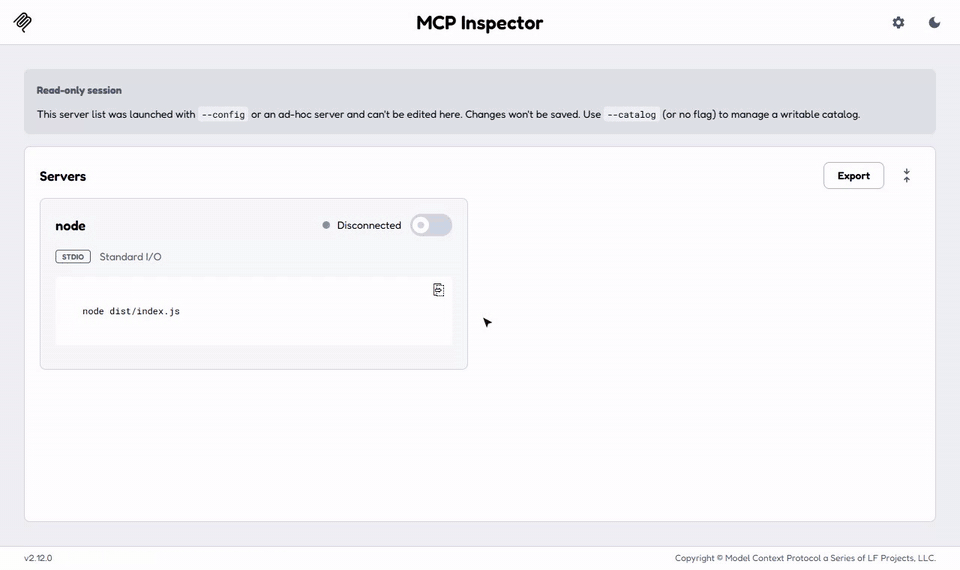
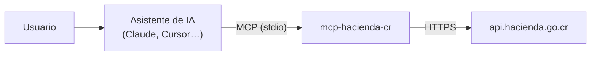

# mcp-hacienda-cr

[](https://github.com/jmnzcn/mcp-hacienda-cr/actions/workflows/ci.yml)
[](https://www.npmjs.com/package/mcp-hacienda-cr)
[](https://www.npmjs.com/package/mcp-hacienda-cr)


Un servidor MCP que le da a Claude, Cursor y otros asistentes de IA acceso a los datos públicos del
Ministerio de Hacienda de Costa Rica: el tipo de cambio, la situación tributaria de un contribuyente,
los códigos CABYS con su tarifa de IVA y las exoneraciones. Además valida el XML de una factura
electrónica 4.4 antes de enviarla: contra el esquema oficial, sus cuentas y los datos de Hacienda. Lo
hice pensando en la facturación electrónica, donde cada línea de una factura necesita su código CABYS
y el IVA correcto, y un error se descubre cuando Hacienda rechaza el comprobante.

Está publicado en npm y en el [registro oficial de MCP](https://registry.modelcontextprotocol.io/v0/servers?search=hacienda)
como `io.github.jmnzcn/mcp-hacienda-cr`.

[English summary](#english-summary)



<sub>Grabado con [MCP Inspector](https://github.com/modelcontextprotocol/inspector) contra la API real de Hacienda: el tipo de cambio del día, los códigos CABYS de "café tostado" con su IVA y la situación tributaria de la CNFL.</sub>

## Qué le podés preguntar a tu asistente

> "¿Qué código CABYS uso para vender café tostado y cuánto IVA lleva?"
>
> Hay 71 códigos para café tostado. Por ejemplo, `2391102010100` (café tostado sin descafeinar, en
> grano) paga IVA del 1 %, pero `2391102020000` (café tostado descafeinado) paga 13 %.

> "Antes de facturarle, ¿la empresa 3-101-000046 está al día con Hacienda?"
>
> COMPAÑIA NACIONAL DE FUERZA Y LUZ S.A. · Cédula jurídica · Régimen general · Al día (no morosa ni
> omisa) · Actividad principal: 3510.0, generación, transmisión y distribución de energía eléctrica.

> "Revisá esta factura antes de que la envíe" (con el XML adjunto)
>
> ❌ Factura electrónica tiene 1 error y 1 advertencia.
> - Esquema oficial 4.4: cumple (validado como borrador, sin firma)
> - ❌ Resumen › TotalComprobante: dice 26 980,00, pero venta neta + impuesto + otros cargos − IVA
>   devuelto da 26 880,00 (diferencia 100,00).
> - ⚠️ Línea 2 › Impuesto › Tarifa: cobra IVA 13 %, pero el CABYS 0161001010000 (café cereza,
>   orgánico) tiene 1 %.

También: "¿A cuánto está el dólar hoy?" o "¿La exoneración AL-00020402-24 sigue vigente?". Son
respuestas reales del servidor contra la API de Hacienda.

## Herramientas

- `tipo_de_cambio`: el tipo de cambio de referencia del día, dólar (compra y venta) y euro.
- `consultar_contribuyente`: nombre, tipo de identificación, régimen, estado, si está moroso u omiso
  y sus actividades económicas. Ejemplo: `3-101-000046`.
- `buscar_cabys`: busca códigos CABYS por descripción, con su tarifa de IVA. Ejemplo: `café tostado`.
- `obtener_cabys`: el detalle de un código CABYS, con su IVA y su categoría. Ejemplo: `0161001010000`.
- `consultar_exoneracion`: beneficiario, porcentaje, vigencia y códigos CABYS que cubre una
  exoneración. Ejemplo: `AL-00020402-24`.
- `validar_factura`: revisa el XML de un comprobante 4.4, firmado o sin firmar, y explica cada
  problema en español. Ejemplo: [examples/factura-con-errores.xml](examples/factura-con-errores.xml).

Todas son de solo lectura y usan las APIs públicas de Hacienda, así que no hace falta registrarse ni
tener una API key.

## Instalación

Requiere Node.js 18 o superior.

En Claude Desktop, agregalo a `claude_desktop_config.json` (Configuración → Desarrollador → Editar
configuración):

```json
{
  "mcpServers": {
    "hacienda-cr": {
      "command": "npx",
      "args": ["-y", "mcp-hacienda-cr"]
    }
  }
}
```

En Claude Code:

```bash
claude mcp add hacienda-cr -- npx -y mcp-hacienda-cr
```

En Cursor, VS Code y otros clientes MCP, usá el comando `npx -y mcp-hacienda-cr` con transporte stdio.

## Qué revisa `validar_factura`

Sirve para los ocho tipos de comprobante 4.4: factura, tiquete, notas de crédito y de débito, factura
de compra, factura de exportación, recibo electrónico de pago y mensaje receptor.

1. **El esquema oficial.** Valida el XML contra los XSD de Hacienda en la revisión vigente desde el 1 de
   noviembre de 2026 (vienen incluidos; su origen está en [schemas/v4.4/FUENTE.md](schemas/v4.4/FUENTE.md)).
   Si el comprobante no está firmado, lo valida como borrador y lo avisa. Si usa el espacio de nombres
   de la versión 4.3, lo dice.
2. **Las cuentas.** Revisa cada línea y el resumen con las fórmulas que documentan los propios esquemas:
   cantidad × precio, descuentos, IVA según la tarifa, impuesto neto, total de la línea, gravado +
   exento + exonerado + no sujeto, venta neta, desglose por tarifa, total del comprobante y medios de
   pago. Compara al céntimo.
3. **La clave y el consecutivo.** Comprueba que la clave de 50 posiciones tenga la fecha, la
   identificación del emisor y el consecutivo del documento, y que el consecutivo sea del tipo de
   comprobante correcto.
4. **Los datos de Hacienda.** Comprueba que el emisor y el receptor estén registrados, que la actividad
   económica sea del emisor, que cada CABYS exista y cobre su IVA, que cada exoneración exista, esté
   vigente, sea del receptor y cubra el CABYS, y que el tipo de cambio en dólares se parezca al de
   referencia del día. Si Hacienda no responde, lo avisa sin invalidar el comprobante.

No verifica la firma criptográficamente ni reemplaza la aceptación de Hacienda: es una revisión previa
para no enviar comprobantes que van a ser rechazados.

## Cómo funciona



Está escrito en TypeScript con el [SDK oficial de MCP](https://github.com/modelcontextprotocol/typescript-sdk),
y cada herramienta valida su entrada con Zod antes de llamar a Hacienda: una cédula física tiene 9
dígitos, una jurídica o NITE 10, un DIMEX 11 o 12, y un código CABYS 13. Cada respuesta trae un texto
legible para la conversación y los datos exactos en `structuredContent` para que el modelo trabaje
con ellos. Si la cédula no es válida, el código no existe o la API de Hacienda está caída, el usuario
recibe un mensaje claro en vez de un error. Las respuestas quedan en caché 10 minutos (tipo de cambio)
o una hora (lo demás) para no saturar la API.

## Pruebas

Hay 44 pruebas unitarias del cliente, el validador y el servidor completo, con un cliente MCP real en
memoria y respuestas de Hacienda grabadas. Las del validador parten de una factura que cuadra y la
rompen de a un error por vez. Además, el validador se probó con los siete comprobantes de ejemplo de
[DojoCodingLabs/hacienda-cr](https://github.com/DojoCodingLabs/hacienda-cr), generados por otro
proyecto: todos pasan. Aparte, unas pruebas de contrato llaman a la API real para detectar
si Hacienda cambia el formato de sus respuestas, y una prueba de humo levanta el servidor compilado
por stdio, como lo haría Claude, y llama a las seis herramientas. El CI corre en Node 18, 20 y 22 en
cada push, y las pruebas contra la API real también cada lunes, para enterarme antes que los usuarios
si algo cambia.

```bash
npm install
npm test            # unitarias, sin red
npm run test:live   # contrato con la API real de Hacienda
npm run smoke       # servidor compilado por stdio, de punta a punta
```

## Aviso

Los datos vienen de las APIs públicas del Ministerio de Hacienda y son de referencia. Este proyecto no
está afiliado al Ministerio de Hacienda. Las decisiones fiscales confirmalas con un contador o
directamente con Hacienda.

## Licencia

[PolyForm Noncommercial 1.0.0](LICENSE). Podés usarlo gratis para fines no comerciales: uso personal,
investigación, educación o para evaluarlo. Cualquier uso comercial necesita una licencia:
[neyfred@gmail.com](mailto:neyfred@gmail.com). Las versiones hasta el commit `438da02` (2026-10-26),
incluida la 0.1.1 publicada en npm, se publicaron con licencia MIT.

## English summary

mcp-hacienda-cr is a [Model Context Protocol](https://modelcontextprotocol.io) server that lets AI
assistants such as Claude and Cursor query the public APIs of Costa Rica's Ministry of Finance:
official exchange rates, taxpayer status (registered, delinquent or non-filer, economic activities),
CABYS product and service codes with their VAT rate, and tax exemptions. It also validates a v4.4
e-invoice XML before it is sent: against the official schemas, its own arithmetic, and Hacienda's data
(taxpayers, CABYS VAT rates, exemptions), explaining each problem in Spanish. It is aimed at
e-invoicing, where every invoice line needs a CABYS code and the right VAT rate. No API key is needed. It is
listed in the official MCP registry and installs with one command:

```bash
claude mcp add hacienda-cr -- npx -y mcp-hacienda-cr
```

Ney Fred Jiménez Campos · [LinkedIn](https://www.linkedin.com/in/neyfred/) · [GitHub](https://github.com/jmnzcn)
